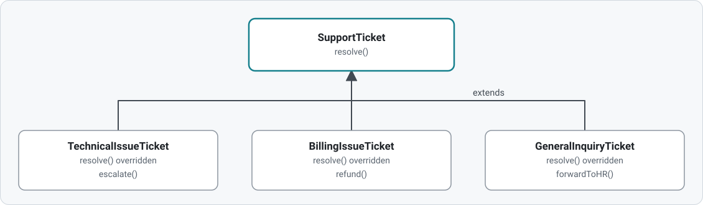
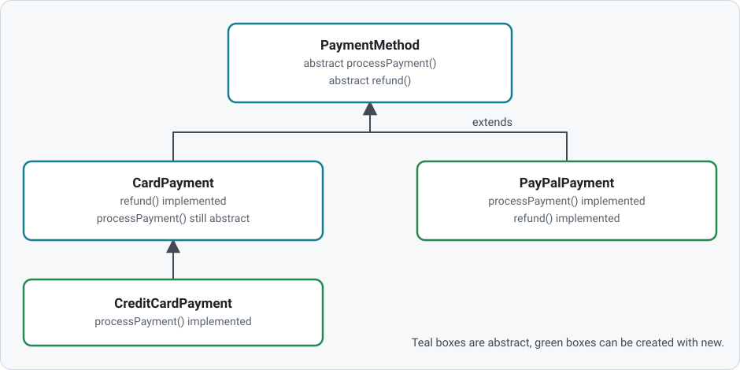

## Classes

TypeScript classes and the features it adds on top of ES6 classes. Covers access modifiers (`public`, `private`, `protected`), ES private fields (`#`) vs TypeScript `private`, parameter properties, getters and setters, method overriding with the `override` keyword, polymorphism and `instanceof` narrowing, abstract classes, implementing interfaces, constructor overloads, static members and the Singleton pattern, losing `this` and the fixes, fluent APIs with `this` return types, and structural typing.

### Who can reach a member

| Modifier    | Inside the class | In a subclass | Outside |
| ----------- | ---------------- | ------------- | ------- |
| `public`    | yes              | yes           | yes     |
| `protected` | yes              | yes           | no      |
| `private`   | yes              | no            | no      |

All three are checked by the compiler only. `#field` is the one the JavaScript engine enforces
at runtime ([02](02-esPrivateVsPrivate.ts)).

### Polymorphism, as drawn in lesson 07

<picture>
  <source media="(prefers-color-scheme: dark)" srcset="diagrams/polymorphism-dark.svg">
  
</picture>

A list typed `SupportTicket[]` can call `resolve()` on every element, and each subclass runs its
own version. Only after an `instanceof` check can you call `escalate()`, `refund()` or
`forwardToHR()`.

### Abstract classes closed in steps, as drawn in lesson 08

<picture>
  <source media="(prefers-color-scheme: dark)" srcset="diagrams/abstractLevels-dark.svg">
  
</picture>

`CardPayment` closes `refund()` and leaves `processPayment()` open, so it is still abstract and
cannot be created with `new`. `CreditCardPayment` closes the rest.
