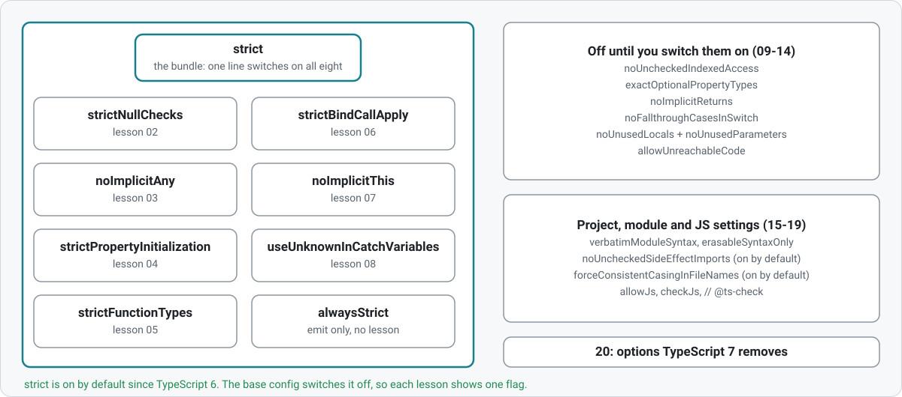

## Compiler Flags

Walkthrough of the TypeScript compiler flags that matter for type safety and project hygiene.

Each lesson is a self-contained folder in this one. Each folder has:

- `index.ts` — example code with `@ts-expect-error` markers showing what the flag catches
- `tsconfig.json` — extends the shared base, enables only the flag(s) for that lesson

<picture>
  <source media="(prefers-color-scheme: dark)" srcset="diagrams/strictBundle-dark.svg">
  
</picture>

### Run

```sh
npm run check                  # type-check every lesson of every topic in turn
npx tsc -p flags/01-strict     # type-check a single lesson
```

### Lessons

| #   | Lesson                                           | What it is                                    |
| --- | ------------------------------------------------ | --------------------------------------------- |
| 01  | `strict`                                         | the bundle, and what lies outside it          |
| 02  | `strictNullChecks`                               | inside `strict`                               |
| 03  | `noImplicitAny`                                  | inside `strict`                               |
| 04  | `strictPropertyInitialization`                   | inside `strict`                               |
| 05  | `strictFunctionTypes`                            | inside `strict` (with a 🎓 on method syntax)  |
| 06  | `strictBindCallApply`                            | inside `strict`                               |
| 07  | `noImplicitThis`                                 | inside `strict`                               |
| 08  | `useUnknownInCatchVariables`                     | inside `strict`                               |
| 09  | `noUncheckedIndexedAccess`                       | a check `strict` leaves off                   |
| 10  | `exactOptionalPropertyTypes`                     | a check `strict` leaves off                   |
| 11  | `noImplicitReturns`                              | a check `strict` leaves off                   |
| 12  | `noFallthroughCasesInSwitch`                     | a check `strict` leaves off                   |
| 13  | `noUnusedLocals` + `noUnusedParameters`          | a check `strict` leaves off                   |
| 14  | `allowUnreachableCode`                           | a check `strict` leaves off                   |
| 15  | `verbatimModuleSyntax`                           | project setting (with a 🎓 on module formats) |
| 16  | `erasableSyntaxOnly`                             | project setting                               |
| 17  | `noUncheckedSideEffectImports`                   | project setting, on by default                |
| 18  | `forceConsistentCasingInFileNames`               | project setting, on by default                |
| 19  | JS interop: `allowJs`, `checkJs`, `// @ts-check` | project setting                               |
| 20  | Options removed in TypeScript 7                  | reading: what 6 deprecates and 7 removes      |

### Which flags need another

The shared `tsconfig.base.json` sets `"strict": false`, so each lesson turns on only its own flag.
A lesson whose flag depends on another sets both in its `tsconfig.json` and says so at the top:

| Lesson                            | Also set              | Why                                              |
| --------------------------------- | --------------------- | ------------------------------------------------ |
| 04 `strictPropertyInitialization` | `strictNullChecks`    | without `undefined` as a type nothing is missing |
| 09 `noUncheckedIndexedAccess`     | `strictNullChecks`    | the flag adds `undefined` to a type              |
| 10 `exactOptionalPropertyTypes`   | `strictNullChecks`    | the flag separates `undefined` from "missing"    |
| 07 `noImplicitThis`               | `strictBindCallApply` | the `.call` check at the end needs it            |

### A note on versions

This topic pins **TypeScript 6**. `strict` is on by default since TypeScript 6.0 (an empty
tsconfig reports the strict errors on 6.0.2 and on 7.0.2), and so is
`noUncheckedSideEffectImports`; TypeScript 7 changes neither. What TypeScript 7 changes is the
configuration: options that TypeScript 6 deprecates are removed. Lesson 20 lists them, with
what each version reports.

The workshop cannot move to 7 yet: `typescript-eslint` still caps its peer
dependency at `typescript <6.1.0`, so upgrading would break `npm run lint`. The
`native-compiler` branch covers TypeScript 7 on its own, without eslint.
