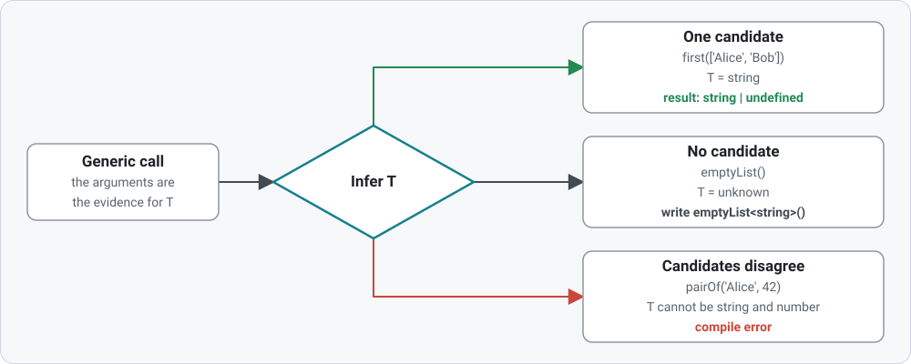
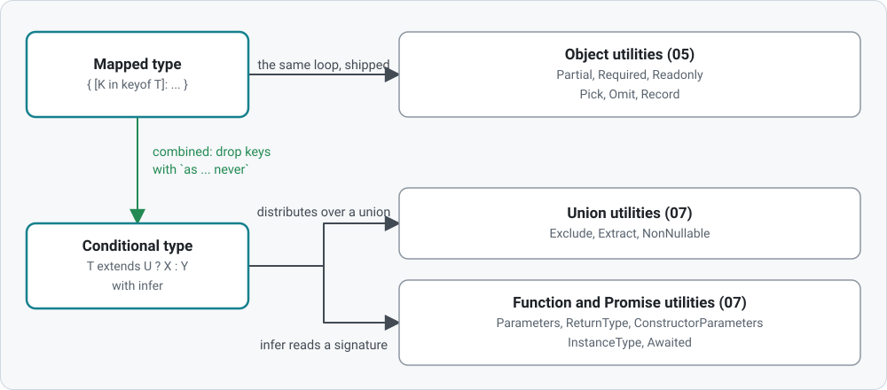

## Generics

Type parameters, and the types you can compute from other types. Covers generic functions (and how `T` is inferred), generic aliases, interfaces and classes, constraints, mapped types, the built-in utility types, conditional types with `infer`, template literal types, the `ts-reset` library, and generics in real projects. It builds on [types](../types) (`keyof`, `typeof` and indexed access are in [types/14](../types/14-typeofKeyofIndexedAccess.ts)) and uses [classes](../classes) for `implements`.

The folder compiles with `strict` on (see its `tsconfig.json`). `reset.d.ts` loads the `ts-reset` library for every file in the folder; [09](09-tsReset.ts) explains what it changes.

### How `T` is decided

<picture>
  <source media="(prefers-color-scheme: dark)" srcset="diagrams/inference-dark.svg">
  
</picture>

Drawn from lessons [01](01-genericFunctions.ts) and [02](02-genericTypes.ts).

### Lessons

| #   | Lesson                                                                 | Covers                                                                                                                 |
| --- | ---------------------------------------------------------------------- | ---------------------------------------------------------------------------------------------------------------------- |
| 01  | [Generic functions](01-genericFunctions.ts)                            | `<T>`, inference, explicit type arguments, when a type parameter earns its place                                       |
| 02  | [Generic types](02-genericTypes.ts)                                    | aliases, interfaces, classes, default type arguments                                                                   |
| 03  | [Constraints](03-constraints.ts)                                       | `extends`, keeping the caller's type, `K extends keyof T`, `const` type parameters                                     |
| 04  | [Mapped types](04-mappedTypes.ts)                                      | `[K in ...]`, `readonly`/`?` modifiers and `-`, key remapping with `as`; 🎓 mapped types on arrays                     |
| 05  | [Object utility types](05-objectUtilityTypes.ts)                       | `Partial`, `Required`, `Readonly`, `Pick`, `Omit`, `Record`                                                            |
| 06  | [Conditional types](06-conditionalTypes.ts)                            | `T extends U ? X : Y`, distribution, `infer`, filtering keys; 🎓 a conditional return type                             |
| 07  | [Union and function utility types](07-unionAndFunctionUtilityTypes.ts) | `Exclude`, `Extract`, `NonNullable`, `Parameters`, `ReturnType`, `Awaited`; 🎓 `Awaited` written out, `createInstance` |
| 08  | [Template literal types](08-templateLiteralTypes.ts)                   | string types built from parts, `Capitalize` and friends, typed handlers; 🎓 route parameters                           |
| 09  | [ts-reset](09-tsReset.ts)                                              | `filter(Boolean)`, `JSON.parse`, `includes`                                                                            |
| 10  | [Generics in real projects](10-realWorldPatterns.ts)                   | API client, typed event emitter, `ValuesType`; 🎓 a builder                                                            |

### Which utility type comes from what

<picture>
  <source media="(prefers-color-scheme: dark)" srcset="diagrams/utility-map-dark.svg">
  
</picture>
