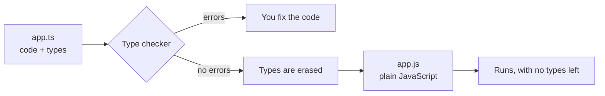
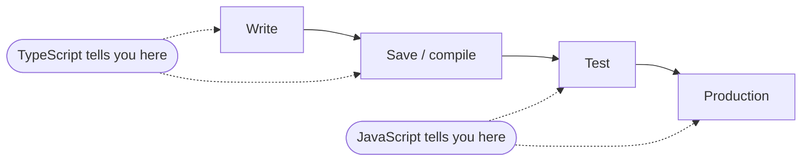

# TypeScript: pros and cons

TypeScript is JavaScript plus a type checker. The checker runs before your code does, reads
the types you (or the compiler) attached to values, and reports the places where the code
disagrees with them. Then it erases the types and what runs is plain JavaScript.



Everything below follows from those two facts: the checker runs early, and the types are
gone at runtime.

## What the checker catches

Take a small function and two calls that are wrong.

```ts
type Order = { id: string; total: number };

function applyDiscount(order: Order, percent: number): Order {
  return { ...order, total: order.total * (1 - percent / 100) };
}

applyDiscount({ id: 'A-1001', total: 80 }, '15');
// Error: Argument of type 'string' is not assignable to parameter of type 'number'.

applyDiscount({ id: 'A-1002', totl: 80 }, 15);
// Error: Object literal may only specify known properties, but 'totl' does not exist
//        in type 'Order'. Did you mean to write 'total'?
```

In plain JavaScript neither call fails. The first one quietly works, because JavaScript
turns `'15'` into a number (the order comes out as `68`). The second returns an order with
`total: NaN` and an extra `totl: 80` field. Nobody is told; the bug turns up later, in
whoever reads the total.

The point of running the checker early is to move the moment you learn about a mistake
to the left:



## Pros

- **Mistakes surface where you make them.** The error is on the line, in the editor, before
  you run anything. Typos, wrong argument order, a missing `null` check.
- **The code explains itself.** A signature says what goes in and what comes out. You can
  read `applyDiscount(order: Order, percent: number): Order` without reading its body.
- **Tooling gets much better.** Autocomplete, go to definition, find all references and
  rename-across-the-project all work because the editor knows the types.
- **Refactoring is safer.** Rename a field and the compiler lists every place that still
  uses the old name.
- **You can adopt it gradually.** A JavaScript project can move file by file
  (`allowJs`, see the flags topic), and most popular libraries ship their own types.
- **It stays JavaScript.** Any valid JavaScript idea can be written in it, and the output
  runs anywhere JavaScript runs.

## Cons

- **A build step.** Something has to turn `.ts` into `.js` (or the runtime has to strip the
  types). That is one more tool to configure and keep working.
- **A learning curve.** Basic annotations take an afternoon. Generics, conditional types and
  the compiler's error messages for them take much longer.
- **More to write and read.** Some code gets longer, and advanced types can get hard to
  follow. Types are code, and they need the same care as code.
- **Types are erased, so they are promises, not proof.** The checker believes what you tell
  it. Data that arrives from outside (a network response, a file, user input) is not
  checked at runtime:

  ```ts
  const response = JSON.parse('{"total":"80"}'); // type: any
  const total: number = response.total; // OK, and wrong
  console.log(typeof total); // string
  ```

  ```mermaid
  flowchart LR
    ext["Outside data<br/>network, file, user"] -- "JSON.parse gives any" --> edge{{"Validate at the boundary"}}
    edge -- "typed value" --> code["Your typed code"]
  ```

  Fix this at the boundary with a runtime validator, not with more annotations. The types
  lesson on `any`, `unknown` and `never` shows why `JSON.parse` returns `any`.

- **Escape hatches exist.** `any`, `as` and `// @ts-ignore` switch the checker off for a
  line. A codebase full of them has the cost of TypeScript and little of the benefit.
- **It does not test your logic.** `applyDiscount` can type-check and still apply the wrong
  discount. Tests are still needed.
- **Imperfect third-party types.** A library's type definitions can be wrong, out of date,
  or missing.

## So when is it worth it?

The benefit grows with how long the code lives and how many people touch it. For a
throwaway script, plain JavaScript is fine. For anything that is maintained for months,
shared between people, or changed often, the early errors and the refactoring support pay
for the setup within weeks.

## What we do in this workshop

We turn the checker up (`strict`), learn what it can say, and learn where it stops. The
next talk covers a newer reason to care: [TypeScript in the AI era](02-typescriptInTheAiEra.md).
