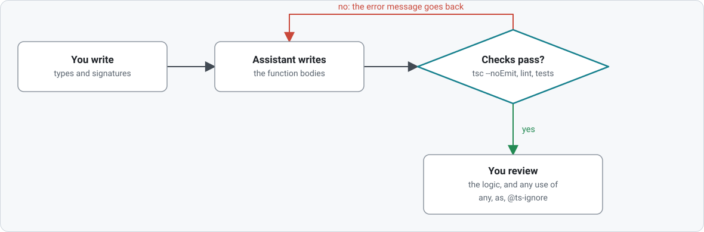

# TypeScript in the AI era

More and more code is first drafted by an assistant, and a person reads it afterwards.
That changes what a language has to offer. Writing code gets cheaper; **checking that the
code is right** becomes the expensive part. TypeScript's types are a cheap, automatic way
to check a large part of it.

## A feedback loop a machine can run

An assistant can write code, but it cannot see whether the code is correct unless
something tells it. The type checker tells it, in seconds, on the exact line, often with
the fix:

```
error TS2561: Object literal may only specify known properties, but 'totl' does not
exist in type 'Order'. Did you mean to write 'total'?
```

An assistant (or a CI job) can run `tsc --noEmit` after every change, read that message,
and correct itself without a human. Plain JavaScript gives no such signal until a test or
a user hits the bug. TypeScript 7 runs the same checker ported to Go, so the loop gets
faster still.

<picture>
  <source media="(prefers-color-scheme: dark)" srcset="diagrams/ai-loop-dark.svg">
  
</picture>

## Types are context

A signature tells a model (and a new teammate) what a function expects and returns without
reading the body. A project whose data has names (`Order`, `UserId`) gives an assistant
more to work from than one made of loose objects, and the assistant's suggestions are
checked against those names.

Writing the types first is a practical way to work: describe the shape of the data and the
function signatures yourself, let the assistant fill in the bodies, and let the compiler
tell you whether the bodies respect your design.

## Review gets cheaper where types carry the load

Reviewing generated code is the new bottleneck. When a function compiles under `strict`,
the reviewer does not have to re-check that arguments line up or that `null` is handled.
Review time goes to what the compiler cannot see: whether the logic is right.

## Where it still goes wrong

- **Assistants silence the compiler.** The quickest way to make an error disappear is
  `any`, `as` or `// @ts-ignore`. Treat each one in a diff as a question for the author.
  The lessons on `any`/`unknown` and on assertions show what they give up, and a lint rule
  can ban the worst of them.
- **A green build is not a correct program.** Types check shapes, not behaviour. Keep tests.
- **Data from outside is not checked.** Model output, like any JSON, arrives as untyped
  text. Parse it with a runtime validator and let the validator produce your type.
- **Plausible but wrong types.** An assistant can write a clever conditional type that
  compiles and nobody understands. Prefer the simple type, and mark what you do not follow
  as something to learn (look for 🎓 in these lessons).

## What to take away

1. Keep `strict` on; it is the part of the checker that catches the most.
2. Make the compiler and linter part of every automated change: `tsc --noEmit`, lint, tests.
3. Write the types, let the tools write the bodies, and review the places where types were
   weakened.
4. Validate untyped data at the edge.

These lessons teach what the checker can and cannot say, which is also what you need to
judge an assistant's work. Before the first lesson, [how to read the lessons](03-howToReadTheLessons.md) explains the markers.
