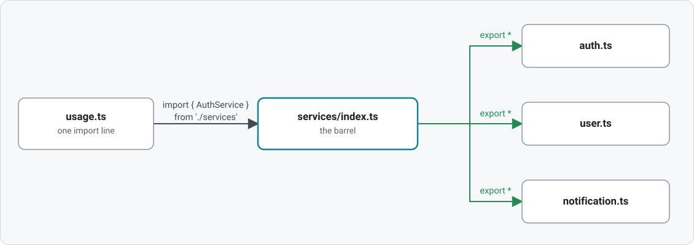
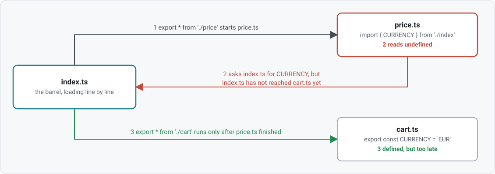
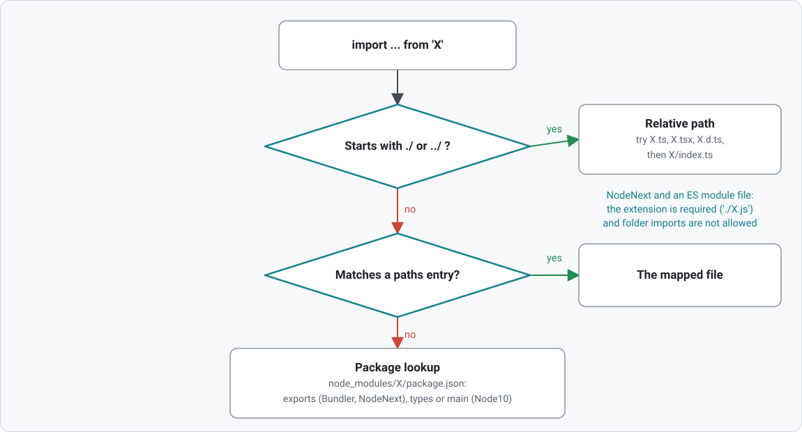

## Modules

ES modules in TypeScript: `import`/`export`, default vs named exports, re-exports and barrel files, type-only imports, dynamic `import()`, path aliases and module resolution. Lessons marked 🎓 contain a section the presenter skips in the room; study it afterwards.

<picture>
  <source media="(prefers-color-scheme: dark)" srcset="diagrams/barrel-dark.svg">
  
</picture>

<picture>
  <source media="(prefers-color-scheme: dark)" srcset="diagrams/cycle-dark.svg">
  
</picture>

### Lesson files

1. **Named Exports and Imports** (`01-namedExports/`) — inline vs list exports, `as` renames, `import * as`, what stays private
   - `api.ts` — the module that exports
   - `usage.ts` — imports from `api.ts`
2. **Default Exports vs Named Exports** (`02-defaultExport/`) — syntax, the naming problem, when a default is right
   - `logger.ts` — default export of a class + named exports
   - `usage.ts` — imports under different names
3. **Re-exports and Barrel Files** (`03-reExportsAndBarrelFiles/`) — `export *`, default exports and barrels, name clashes, bundle cost; 🎓 circular imports through a barrel
   - `services/` — auth, user, notification services with an `index.ts` barrel
   - `conflict/` — two modules exporting the same name
   - `loading/` — the same import through a feature barrel and a root barrel, with what node loads
   - `cycle/` — 🎓 a barrel that loads itself in the wrong order
   - `usage.ts` — imports everything through the barrel
4. **Type-Only Imports and Exports** (`04-typeOnlyImports/`) — `import type`, inline `type`, `export type`, `export type *`, what the emitted JS keeps
   - `types.ts`, `analytics.ts` — types, a value, and a module with a side effect
   - `index.ts` — a barrel with type-only re-exports
   - `usage.ts` — the lesson
5. **Dynamic Imports** (`05-dynamicImports/`) — `import()`, loading on a condition, `typeof import()`, string-literal gotcha
   - `heavy.ts` — module loaded on demand
   - `usage.ts` — the lesson
6. **Path Aliases** (`06-pathAliases/`) — tsconfig `paths`, the `@app/*` alias, why the emitted JS keeps the alias
7. **Module Resolution** (`07-moduleResolution/`) — how a specifier becomes a file, Bundler vs NodeNext vs Node10; 🎓 `package.json` `exports`
   - `User/` — a folder with an `index.ts`, imported by folder name

<picture>
  <source media="(prefers-color-scheme: dark)" srcset="diagrams/resolution-dark.svg">
  
</picture>

### Running a lesson

The lessons import each other without file extensions, which a bundler accepts and
node does not. Compile the folder to CommonJS, then run a lesson's output:

```sh
npx tsc -p modules --noEmit false --module commonjs --outDir dist/modules
node dist/modules/04-typeOnlyImports/usage.js
```

`dist/` is ignored by git, eslint and prettier. 06 and 07 stop with
`Cannot find module '@app/utils'`: node does not read tsconfig `paths`, which is 06's lesson.

### Supporting files

- `types.ts` — shared type definitions imported via the `@app/types` alias
- `utils/` — a barrel using the alias
