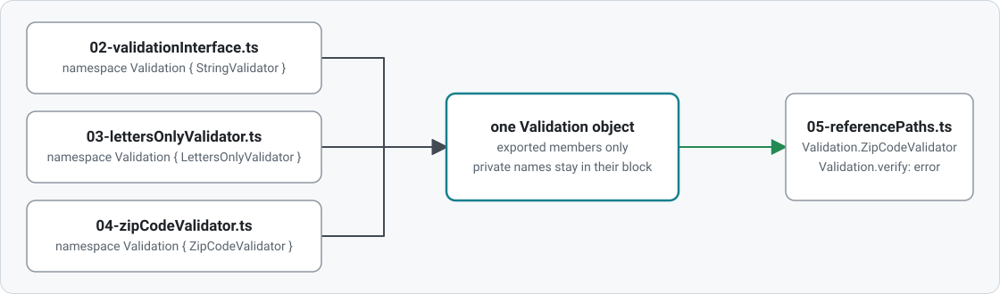

## Namespaces

TypeScript's `namespace` was the original way to organize code before ES modules. It is worth knowing for reading legacy code and global `.d.ts` files; new code uses modules ([../modules](../modules/README.md)).

These files have no import/export, so they share one global scope. Files 02 to 05 build one `Validation` namespace out of three files.

| File                                                                     | What it teaches                                                                                                     |
| ------------------------------------------------------------------------ | ------------------------------------------------------------------------------------------------------------------- |
| [01-namespaceBasics.ts](01-namespaceBasics.ts)                           | `namespace` blocks, `export`, private members, blocks of the same name merging, nested namespaces, `import X = A.B` |
| [02-validationInterface.ts](02-validationInterface.ts)                   | The shared interface of a namespace split across files                                                              |
| [03-lettersOnlyValidator.ts](03-lettersOnlyValidator.ts)                 | A second file reopening the same namespace, `/// <reference path>`                                                  |
| [04-zipCodeValidator.ts](04-zipCodeValidator.ts)                         | A third file reopening it                                                                                           |
| [05-referencePaths.ts](05-referencePaths.ts)                             | Using the merged namespace; 🎓 why `outFile` bundles need the reference lines                                       |
| [06-mergingWithOtherDeclarations.ts](06-mergingWithOtherDeclarations.ts) | 🎓 Merging a namespace with a function, enum or class                                                               |
| [07-namespacesToday.ts](07-namespacesToday.ts)                           | `declare namespace` for global typings; why modules replaced namespaces                                             |

### Three files, one object

<picture>
  <source media="(prefers-color-scheme: dark)" srcset="diagrams/mergedNamespace-dark.svg">
  
</picture>

### Build the bundle

`npm run build:outfile` compiles `05-referencePaths.ts` and everything it references into `dist/bundle.js` (git-ignored); `node namespaces/dist/bundle.js` runs it.
