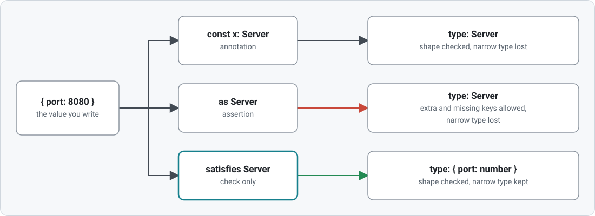

## The `satisfies` Operator

`value satisfies Type` checks that a value fits a type and keeps the type TypeScript inferred from the value. The lessons compare it with the two other ways to relate a value to a type: an annotation and `as` ([../types/13-assertionsAndAsConst.ts](../types/13-assertionsAndAsConst.ts)).

| File                                                       | What it teaches                                                                            |
| ---------------------------------------------------------- | ------------------------------------------------------------------------------------------ |
| [AppConfig.ts](AppConfig.ts)                               | The settings type the lessons validate against                                             |
| [01-whatSatisfiesChecks.ts](01-whatSatisfiesChecks.ts)     | Typos, missing keys and wrong values caught; the narrow inferred type kept                 |
| [02-satisfiesVsAnnotation.ts](02-satisfiesVsAnnotation.ts) | Same check, different type afterwards; where the annotation is still right                 |
| [03-satisfiesVsAs.ts](03-satisfiesVsAs.ts)                 | What `as` lets through that `satisfies` rejects; all three forms side by side              |
| [04-asConstSatisfies.ts](04-asConstSatisfies.ts)           | `as const satisfies` for route maps and constants                                          |
| [05-limitsOfSatisfies.ts](05-limitsOfSatisfies.ts)         | Non-literal values and `any` slip through; 🎓 the target typing callbacks inside the value |

### What each form does to the variable's type

<picture>
  <source media="(prefers-color-scheme: dark)" srcset="diagrams/threeForms-dark.svg">
  
</picture>
