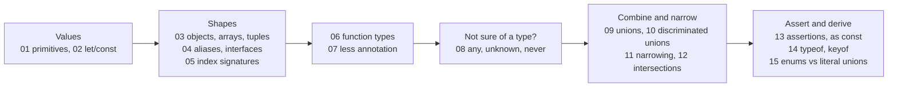

## Types

TypeScript's type system built on top of JavaScript: what a type is, how to describe data and
functions, what to do when you do not know a type yet, how to combine and narrow types, and
how to derive new types from values.

Lessons marked 🎓 inside a file are harder; we skip them in the room and you study them
afterwards. The ✅ / ⚠️ / 🧪 / 🎓 markers are explained at the top of
[`01-primitives.ts`](01-primitives.ts).
